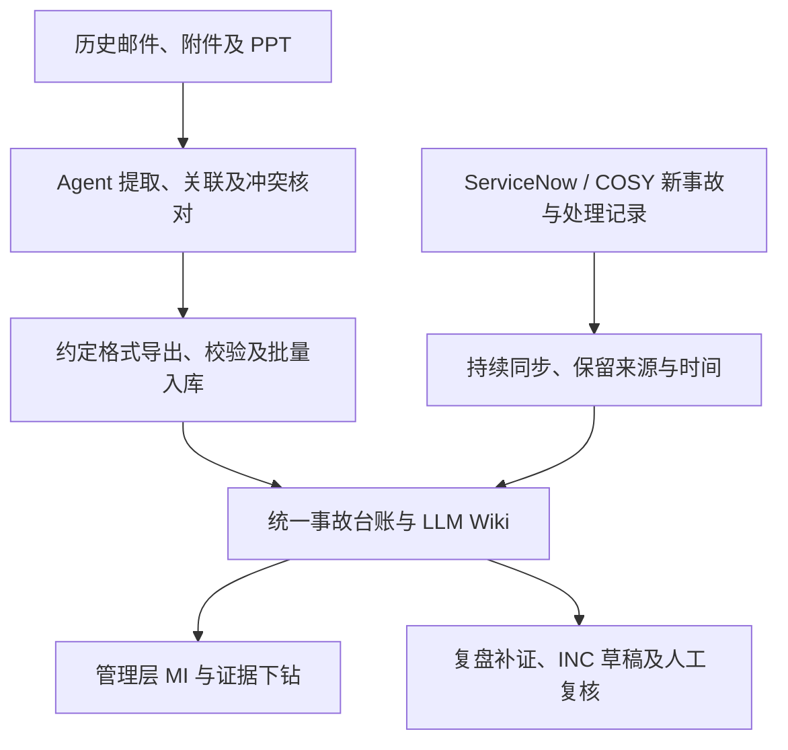

# Production Support & MI

AMH / HASE 管理层 MI 与 Production support 知识库方案 · **讨论稿，尚未批准实施**

仓库：`wwa-lab/production-support-mi`。最新[产品说明书 v0.2](docs/product-brief.md)与本页范围同步维护。

## 一页方案

### 目标与背景

**当前 MVP1 讨论范围：历史事故批量整理、新事故同步与复盘、INC 报告及管理层 MI。** 管理层通过可切换维度、下钻查询的 Dashboard 查看 MI。用户于 2026-10-25 明确：事故处理仍在 ServiceNow / COSY 中，本平台同步记录、协助复盘和出报告。历史材料由 agent 辅助整理到 LLM Wiki，并按约定格式（如 CSV）输出供校验后批量入库；新事故从源工单建立后持续跟踪，不必等到 INC 报告完成才进入台账。具体同步方式及能力尚待盘点（D-10）。

知识检索、现场排障助手、SOP 维护、月度／季度报告中心及现代化反馈继续作为 MVP2 讨论。单次事故 INC 报告纳入 MVP1，替代此前“报告生成全部放 MVP2”的分期表述。[现有虚构 HTML 原型](docs/mi-dashboard.html)已补齐历史导入、新事故同步与复盘、INC 报告流程，并保留原 MI 和 MVP2 预演。新增流程共用本页演练台账，可从管理层 MI 切换到“本次流程演练”；它与原有 7–9 月 30 起示例分开展示，原型不代表真实能力已实现。

支撑知识面向所有 FFer，拟将日常 FF log、支持经验、SOP 和历史 incident / RCA 组织为可追溯的知识库，支持现场排障建议、月度／年度稳定性分析及 HCC modernisation 设计与验证。优先复用现有处理日志，减少重复填写。HCC modernisation 的范围是**整个系统核心从 IBM iSeries 平台迁移到新的开放平台**；目标平台技术栈、迁移方式及本分析需支持的具体决定尚待确认。已知历史事故资料主要在**邮件和 PPT**；FF log 格式与保存渠道、数据完整性、历史年份及获批 AI 工具尚待确认。先共同设计并达成一致，再实施。

### 整体设计

以共享的结构化事故数据与 Karpathy 式 LLM Wiki 支撑 **管理层 MI Dashboard**，并保留 FFer 日常支持场景，优先复用已有平台。管理层通过筛选、维度切换、事故下钻和整改跟进查看 MI；具体数据源、指标口径及实现方式仍待共同确认。

MVP1 的两条数据路径汇入同一份事故台账和 Wiki。ServiceNow / COSY 承担事故处理；本平台展示来源状态、整理证据并维护复盘与报告进度。原系统间的字段权威、事故 ID 映射、同步频率及可获取的历史事件仍待确认。

LLM 提取、关联和归纳；程序计算；领域负责人确认根因和改造判断。台账与 Wiki 引用同一事故 ID 和来源版本。保留未知、缺失及冲突，不以推断替代已确认事实。

历史入库需区分新增、更新、重复和待核对记录；新事故页面需显示源系统更新时间、最近成功同步时间及缺失／冲突提示。业务恢复、RCA 确认、整改完成和报告审核分别记录，不相互代替。上述为设计建议，CSV 字段、同步接口及 INC 模板仍待共同确认。

MVP2 日常支持主线保留为：现场报错日志 → agent 检索历史 case / SOP 并提出建议 → FFer 按既有授权处理 → 结果写入原 FF log → 复核后沉淀知识。FF log 条数、问题数和事故数分别定义，不混算。

INC / RCA 按“一个事故、一组来源、一份可核实的事实记录”组织，RCA 修订不新增事故计数。通过业务流程、系统／组件和故障模式浏览；历史事实经独立的迁移判断关联目标设计、处理决定及验证场景与证据。具体组织方式见 [设计细节](docs/design.md)，仍保留讨论稿状态。

### 交付物

| 交付物 | 内容 |
|---|---|
| 事故台账与数据字典 | 唯一事故 ID、范围、时间、严重级别、原因、整改关联；来源清单、覆盖情况及统计口径 |
| 历史整理与导入包（MVP1） | Wiki 分析与来源引用；按约定格式输出事故、措施及来源关联，校验重复、更新和异常后批量入库 |
| 新事故记录与 INC 报告（MVP1） | 同步源工单与处理时间线；补充复盘证据、生成可追溯草稿并人工复核，保留来源快照及报告版本 |
| FF log 索引与 SOP 草稿 | 引用已有处理日志，仅补缺口；记录 SOP 的适用范围、验证依据、维护与退役关系 |
| LLM Wiki | 事故摘要、系统／组件、重复故障模式及经验；关键事实定位到邮件或 PPT 页码 |
| 现场排障建议 | 根据获准日志与已有 case / SOP，说明首选建议、依据、适用条件、验证和失败处理路径；不自动执行 |
| 趋势报告 | 数量、严重级别、恢复时长、重复问题、RCA 覆盖及整改进展，可下钻至事故 |
| HCC 改造证据清单 | 事故 → 问题机制 → 控制缺口 → 改造候选项 → 验证方式与负责人 |
| 维护机制 | 新资料吸收、RCA 修订、受影响页面检查及人工审核责任 |

### 分期与原型覆盖（讨论用）

各模块可在同一份 [HTML 原型](docs/mi-dashboard.html) 顶部切换；MVP1 入口为管理层 MI、历史整理与导入、事故同步与复盘、INC 报告。分期来自当前共同设计会话，不代表已批准真实产品实施或确定交付日期。

| 分期 / 模块 | 讨论范围及原型覆盖 |
|---|---|
| MVP1 · 管理层 MI | 多维筛选与连续下钻、事故和措施分别计数、整改状态与证据追溯 |
| MVP1 · 历史资料整理与导入 | 6 份虚构来源整理为 3 起候选事故；核对冲突或暂缓，预览 Wiki 与三类 CSV，下载示例并模拟去重入库 |
| MVP1 · 新事故同步与复盘 | 模拟源工单的处理中／恢复／RCA 确认与修订；显示同步失败和来源缺失，关联业务验证并补入复盘摘要 |
| MVP1 · INC 报告 | 生成单次事故的版本化草稿；缺项可存草稿，关键资料齐备后模拟复核；来源变化需重审，可下载虚构 Markdown 报告 |
| MVP2 · 知识检索 | 按关键词、类型和系统查找虚构 case / SOP / RCA / FF Log / 共享 Skill；查看版本、来源及退役状态 |
| MVP2 · 支持助手 | 三种预置日志场景的摘要、排查参考与 RCA 草稿；关联原 FF Log、补充虚构结果与验证记录，形成同次处理的待复核修订 |
| MVP2 · 知识维护 | 承接 FFer 的同次处理修订，核对来源、结果、证据与参考版本；模拟 SME 复核及发布预览；平台与权限角色盘点 |
| MVP2 · 报告中心 | 月度／季度草稿、固定规则摘要、构成事故来源及缺失提示；复用 MI 的虚构台账，独立选择报告范围 |
| MVP2 · 现代化反馈 | 历史机制 → 控制问题 → 设计检查项 → 测试与监控建议；预览待评审记录 |

MVP1 演练路径：载入历史示例 → 整理与核对 → 导出与校验 → 模拟入库 → 新事故同步 → 关联业务验证及复盘摘要 → INC 草稿与模拟复核 → 本次演练 MI。历史台账预置 1 起旧记录；完整核对后新增 2 起、更新 1 起，新同步事故再增加 1 起。重复导入或同步不增加事故数；源 RCA 修订保留旧报告并提示重审。CSV 与报告可下载，但模拟入库／复核仅保留在当前页面，刷新清除。

MVP2 FFer 回流路径：关联原 FF Log → 选择虚构处理结果及验证记录 → 形成待复核修订 → 整理人／SME 核对 → 发布预览。原记录已有字段直接引用；证据缺失可保留待补证草稿，但不能通过复核；改动补充后需重新形成修订并复核。不同日志场景独立保留草稿，仅存在于当前页面，刷新清除。

MVP2 使用内置虚构知识及预置响应，无语义检索、模型调用、导入、真实审核或发布。Git Repo + LLM Wiki + VS Code Agent 作为待评估入口展示；ServiceNow / COSY 的现有能力仍待盘点。管理层 MI 保持当前主线，D-09 / D-10 记录分期及未决条件。

### 试点计划

建议 **两周**，以样本、访问条件和负责人到位为前提；这是讨论估算，不是交付承诺。

下表和 P-01 至 P-06 是原 INC / RCA 资料整理试点提案。MVP1 的批量导入、持续同步及 INC 报告流程需补充样本与验收条件（D-05 / D-10）；FF log 整理、SOP 复用及 agent 排障建议沿用 D-09 讨论。现有试点条件不自动覆盖新增范围，HTML 虚构演示不构成试点验收。

| 阶段 | 工作与产出 |
|---|---|
| 第 1–2 天：共同设计 | 确认来源、范围、指标和 AI 环境；选取 5 个事故，覆盖邮件链、多版 PPT、图表及混合来源 |
| 第 3–5 天：提取验证 | 核对正文、表格、图片与备注；验证来源定位、事故关联和版本处理，决定是否扩样 |
| 第 6–8 天：扩展样本 | 通过验证后扩至约 20–30 个事故，生成台账、Wiki、报表样例和改造候选项 |
| 第 9–10 天：联合评审 | 核实事实和候选项价值，评估校正成本，决定全量范围、投入与责任 |

### 验收与待决事项

样本清单无漏计、重复可解释；数字可复算；关键事实有准确引用；缺失不编造；一次 RCA 修订可识别关联页面；候选改造交由负责人评审。样本仅验证方法，不能推断全量趋势。

需共同确认：历史范围与权威来源、HCC 关注点、指标口径、获批环境、参与人及长期维护负责人。未核实资料完整性前，报表标注“基于已收集资料”。

## 讨论入口

用户同意将面向所有 FFer 的 production support 日常知识库方向纳入讨论稿，补充 FF log 与 SOP 空白模板，并为新系统设计提供借鉴。保留告警／消息／电话触达值班人员、处理后写日志并发给同事的现有流程；知识整理优先引用原日志，仅补缺口，使用反馈也复用原日志／工单。扩展的维护、贡献和使用方式见下方 HTML 讨论稿；具体规则、获批环境和扩展试点尚待共同确认（D-09），不代表已启动实施或导入。

新增现场排障场景：FFer 在获准环境向 agent 提供本次报错日志，agent 检索历史 FF case 与 SOP，给出有依据、注明适用条件的首选补救建议、验证步骤及失败处理路径。处理结果回到现有 FF log；建议生成不等于自动执行或已确认 RCA，能力尚未实施。

| 文档 | 用途 |
|---|---|
| [产品说明书 v0.2](docs/product-brief.md) | 产品定位、MVP1 两条流程、MVP2 分期、数据权威与当前原型边界 |
| [管理层 MI Dashboard（虚构 HTML 原型）](docs/mi-dashboard.html) | MVP1 MI、历史导入、新事故同步／复盘、INC 报告，以及五个 MVP2 模块；全部数据均为虚构 |
| [Production support 维护与贡献讨论稿（HTML）](docs/production-support-guide.html) | 含虚构排障闭环交互演示；日常场景、FF log 整理、贡献流程、SOP 维护及设计借鉴；浏览器可直接打开 |
| [设计细节](docs/design.md) | 历史批量整理、新事故同步与 INC 报告边界，台账、Wiki 与维护规则 |
| [试点与验收](docs/pilot.md) | 样本选择、验证步骤、通过条件 |
| [待决问题与决定记录](docs/decisions.md) | 讨论状态的唯一记录；尚未作出的决定不写成定论 |
| [FF log 记录模板](templates/ff-log.md) | 引用现有处理日志，仅补缺口；关联问题、INC 及 SOP |
| [SOP / Runbook 模板](templates/sop.md) | 从日志与复盘沉淀操作方法，记录适用范围、验证及维护信息 |
| [事故记录模板](templates/incident.md) | 讨论一个事故需要保留哪些信息 |
| [改造候选项模板](templates/modernisation-candidate.md) | 把历史证据连接到可评审的改造建议 |
| [调研来源](docs/references.md) | 原始资料及本方案如何使用它们 |

### 给 FFer 的阅读与反馈方式

先读本页了解范围，再打开 `docs/mi-dashboard.html` 讨论管理层 MI；再切换顶部 MVP2 模块讨论完整产品形态；原支持场景 HTML 保留完整排障闭环讨论，最后按需查看设计与模板。GitHub 文件页显示 HTML 源码；可下载仓库 ZIP 并解压，或 clone 仓库，再用浏览器打开 `docs/mi-dashboard.html` 或 `docs/production-support-guide.html`。两份 HTML 均无外部依赖，可离线演示；保留仓库目录可继续打开其链接的文档和模板。

讨论时引用 `D-01` 等稳定编号，在 Issue / Discussion 中说明场景、建议和待确认问题，或用 PR 提出文档修改。只提交讨论材料与明确标注的虚构例子，不附真实日志或敏感信息；现有文档不代表真实资料上传获批。达成共识后更新决定记录及对应正文。

当前仓库只保存讨论方案、空白模板和虚构 HTML 演示，尚未导入或分析任何真实内部资料；agent、导入和生产操作能力均未实施。
