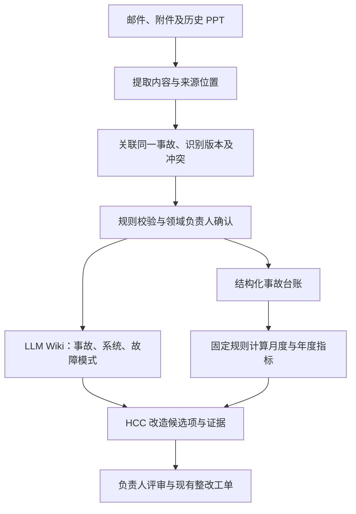

# Lending Incident Wiki

AMH / HASE Production support 知识库方案 · **讨论稿，尚未批准实施**

## 一页方案

### 目标与背景

面向所有 FFer，拟将日常 FF log、支持经验、SOP 和历史 incident / RCA 组织为可追溯的知识库，支持现场排障建议、月度／年度稳定性分析及 HCC modernisation 设计与验证。优先复用现有处理日志，减少重复填写。HCC modernisation 的范围是**整个系统核心从 IBM iSeries 平台迁移到新的开放平台**；目标平台技术栈、迁移方式及本分析需支持的具体决定尚待确认。已知历史事故资料主要在**邮件和 PPT**；FF log 格式与保存渠道、数据完整性、历史年份及获批 AI 工具尚待确认。先共同设计并达成一致，再实施。

### 整体设计

采用 **结构化事故台账 + Karpathy 式 LLM Wiki + 趋势报表**，优先复用已有平台。

日常支持主线为：现场报错日志 → agent 检索历史 case / SOP 并提出建议 → FFer 按既有授权处理 → 结果写入原 FF log → 复核后沉淀知识。以下图示为其中的 INC / RCA 主线；FF log 条数、问题数和事故数分别定义，不混算。

LLM 提取、关联和归纳；程序计算；领域负责人确认根因和改造判断。台账与 Wiki 引用同一事故 ID 和来源版本。保留未知、缺失及冲突，不以推断替代已确认事实。

INC / RCA 按“一个事故、一组来源、一份可核实的事实记录”组织，RCA 修订不新增事故计数。通过业务流程、系统／组件和故障模式浏览；历史事实经独立的迁移判断关联目标设计、处理决定及验证场景与证据。具体组织方式见 [设计细节](docs/design.md)，仍保留讨论稿状态。

### 交付物

| 交付物 | 内容 |
|---|---|
| 事故台账与数据字典 | 唯一事故 ID、范围、时间、严重级别、原因、整改关联；来源清单、覆盖情况及统计口径 |
| FF log 索引与 SOP 草稿 | 引用已有处理日志，仅补缺口；记录 SOP 的适用范围、验证依据、维护与退役关系 |
| LLM Wiki | 事故摘要、系统／组件、重复故障模式及经验；关键事实定位到邮件或 PPT 页码 |
| 现场排障建议 | 根据获准日志与已有 case / SOP，说明首选建议、依据、适用条件、验证和失败处理路径；不自动执行 |
| 趋势报告 | 数量、严重级别、恢复时长、重复问题、RCA 覆盖及整改进展，可下钻至事故 |
| HCC 改造证据清单 | 事故 → 问题机制 → 控制缺口 → 改造候选项 → 验证方式与负责人 |
| 维护机制 | 新资料吸收、RCA 修订、受影响页面检查及人工审核责任 |

### 试点计划

建议 **两周**，以样本、访问条件和负责人到位为前提；这是讨论估算，不是交付承诺。

下表和 P-01 至 P-06 是原 INC / RCA 试点提案。FF log 整理、SOP 复用及 agent 排障建议的扩展试点条件仍待 D-05 / D-09 讨论；HTML 虚构演示不构成试点验收。

| 阶段 | 工作与产出 |
|---|---|
| 第 1–2 天：共同设计 | 确认来源、范围、指标和 AI 环境；选取 5 个事故，覆盖邮件链、多版 PPT、图表及混合来源 |
| 第 3–5 天：提取验证 | 核对正文、表格、图片与备注；验证来源定位、事故关联和版本处理，决定是否扩样 |
| 第 6–8 天：扩展样本 | 通过验证后扩至约 20–30 个事故，生成台账、Wiki、报表样例和改造候选项 |
| 第 9–10 天：联合评审 | 核实事实和候选项价值，评估校正成本，决定全量范围、投入与责任 |

### 验收与待决事项

样本清单无漏计、重复可解释；数字可复算；关键事实有准确引用；缺失不编造；一次 RCA 修订可识别关联页面；候选改造交由负责人评审。样本仅验证方法，不能推断全量趋势。

需共同确认：历史范围与权威来源、HCC 关注点、指标口径、获批环境、参与人及长期维护负责人。未核实资料完整性前，报表标注“基于已收集资料”。

## 讨论入口

用户同意将面向所有 FFer 的 production support 日常知识库方向纳入讨论稿，补充 FF log 与 SOP 空白模板，并为新系统设计提供借鉴。保留告警／消息／电话触达值班人员、处理后写日志并发给同事的现有流程；知识整理优先引用原日志，仅补缺口，使用反馈也复用原日志／工单。扩展的维护、贡献和使用方式见下方 HTML 讨论稿；具体规则、获批环境和扩展试点尚待共同确认（D-09），不代表已启动实施或导入。

新增现场排障场景：FFer 在获准环境向 agent 提供本次报错日志，agent 检索历史 FF case 与 SOP，给出有依据、注明适用条件的首选补救建议、验证步骤及失败处理路径。处理结果回到现有 FF log；建议生成不等于自动执行或已确认 RCA，能力尚未实施。

| 文档 | 用途 |
|---|---|
| [Production support 维护与贡献讨论稿（HTML）](docs/production-support-guide.html) | 含虚构排障闭环交互演示；日常场景、FF log 整理、贡献流程、SOP 维护及设计借鉴；浏览器可直接打开 |
| [设计细节](docs/design.md) | 邮件/PPT 处理、台账、Wiki 与维护规则 |
| [试点与验收](docs/pilot.md) | 样本选择、验证步骤、通过条件 |
| [待决问题与决定记录](docs/decisions.md) | 讨论状态的唯一记录；尚未作出的决定不写成定论 |
| [FF log 记录模板](templates/ff-log.md) | 引用现有处理日志，仅补缺口；关联问题、INC 及 SOP |
| [SOP / Runbook 模板](templates/sop.md) | 从日志与复盘沉淀操作方法，记录适用范围、验证及维护信息 |
| [事故记录模板](templates/incident.md) | 讨论一个事故需要保留哪些信息 |
| [改造候选项模板](templates/modernisation-candidate.md) | 把历史证据连接到可评审的改造建议 |
| [调研来源](docs/references.md) | 原始资料及本方案如何使用它们 |

### 给 FFer 的阅读与反馈方式

先读本页了解范围，再看 HTML 中的“虚构演示”和日常场景，最后按需查看设计与模板。GitHub 文件页显示 HTML 源码；可下载仓库 ZIP 并解压，或 clone 仓库，再用浏览器打开 `docs/production-support-guide.html`。HTML 无外部依赖，可离线演示；保留仓库目录可继续打开其链接的文档和模板。

讨论时引用 `D-01` 等稳定编号，在 Issue / Discussion 中说明场景、建议和待确认问题，或用 PR 提出文档修改。只提交讨论材料与明确标注的虚构例子，不附真实日志或敏感信息；现有文档不代表真实资料上传获批。达成共识后更新决定记录及对应正文。

当前仓库只保存讨论方案、空白模板和虚构 HTML 演示，尚未导入或分析任何真实内部资料；agent、导入和生产操作能力均未实施。
