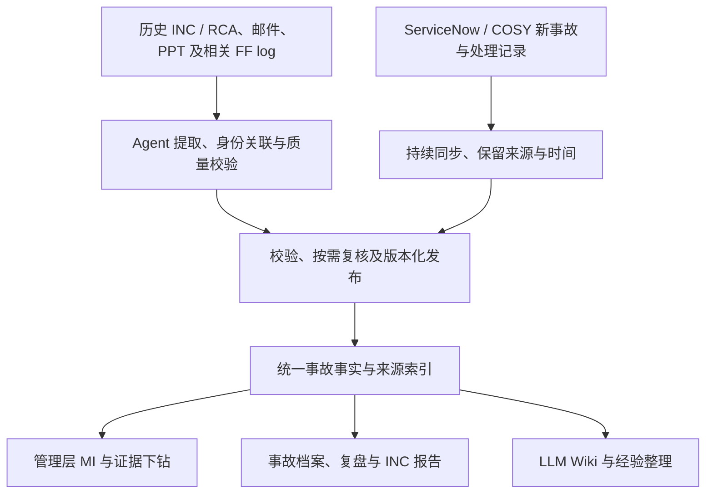

# Production Support & MI

AMH / HASE 管理层 MI 与 Production support 知识库方案 · **讨论稿，尚未批准实施**

仓库：`wwa-lab/production-support-mi`。最新[产品说明书 v0.4](docs/product-brief.md)与本页范围同步维护；2026-10-31 确认先规划 ITSO 多 INC 跟进工作台这一开发切片。本次只更新文档，HTML 仍为原有三入口的虚构原型，不代表新切片或真实能力已实现。

[产品全景图（供管理层与 SME 讨论）](docs/images/product-overview.png)：展示两类资料入口、Agent 与 SME 分工、统一事故档案及 MI／INC／Wiki 产出。仓库组织按本轮同意的“一个产品代码仓库＋独立知识内容仓库”表达；知识仓库尚未创建，图示不代表系统已实施。

阅读入口：[一页方案](#一页方案) · [使用场景](#使用场景) · [文档与讨论入口](#讨论入口)。

## 一页方案

### 目标与背景

**当前 MVP1 讨论范围：历史事故批量整理、新事故同步与复盘、INC 报告及管理层 MI。** 管理层通过可切换维度、下钻查询的 Dashboard 查看 MI。用户于 2026-10-25 明确：事故处理仍在 ServiceNow / COSY 中，本平台同步记录、协助复盘和出报告。历史材料由 agent 辅助整理，保留 Wiki 分析及约定格式（如 CSV）的输出能力；新事故从源工单建立后持续跟踪，不必等到 INC 报告完成才进入台账。具体同步方式及能力尚待盘点（D-10）。

**整体 MVP1 保留的设计方向**：以统一事故档案支撑 MI、Wiki 和报告；源字段校验与专业结论复核分开。首个切片采用下述 ITSO 核对采纳方式，更广范围的自动放行、Wiki 联动及历史 FF log 补证仍待确认。产品代码集中在一个仓库，知识内容独立维护；以后是否再拆分应用代码，按真实团队／权限／交付边界决定。管理层 MI 的业务目标继续保留，当前先解决 ITSO 协调确认和跟进的具体工作；收益需实际验证。详见产品说明第 1、6、7 节。

知识检索、现场排障助手、SOP 维护、月度／季度报告中心及现代化反馈继续作为 MVP2 讨论。单次事故 INC 报告纳入 MVP1，替代此前“报告生成全部放 MVP2”的分期表述。[现有虚构 HTML 原型](docs/mi-dashboard.html)已补齐历史导入、新事故同步与复盘、INC 报告流程，并保留原 MI 和 MVP2 预演。新增流程共用本页演练台账，可从管理层 MI 切换到“本次流程演练”；它与原有 7–9 月 30 起示例分开展示，原型不代表真实能力已实现。

支撑知识面向所有 FFer，拟将日常 FF log、支持经验、SOP 和历史 incident / RCA 组织为可追溯的知识库，支持现场排障建议、月度／年度稳定性分析及 HCC modernisation 设计与验证。优先复用现有处理日志，减少重复填写。HCC modernisation 的范围是**整个系统核心从 IBM iSeries 平台迁移到新的开放平台**；目标平台技术栈、迁移方式及本分析需支持的具体决定尚待确认。已知历史事故资料主要在**邮件和 PPT**；FF log 格式与保存渠道、数据完整性和历史年份尚待确认。用户确认首版已有公司内网环境及部署权限，模型 API 调用权限已获批并在该环境成功调用，且允许保存原始邮件、会议纪要、附件和业务记录；具体配置、访问及保留规则仍待明确，当前会话未独立联调。先共同设计并达成一致，再实施。

### 首个开发切片：ITSO 多 INC 跟进工作台

**本轮确认的是首版范围，尚未批准实现或真实资料接入。** 用户描述主要瓶颈为等待不同人员回复、确认 RCA 和 Follow-up Action；报告过程约一星期是经验描述，尚无计时基线。首版帮助 ITSO 持续掌握变化、分歧、待补信息和各 Owner 的下一步。

- **使用与输入**：公司内部平台负责 `.msg`、PDF 等原始材料解析并转成 Markdown，必须忠实原文、不改写概括，保留原文件名、页码／段落及版本。ITSO 向本工作台上传 Markdown、TXT 或直接粘贴正文；工作台不自建原文件解析库或 OCR。覆盖简繁中文及英文混合内容，接收数量和大小待样本确认；区分新内容和旧引用。SME、Action Owner、Reviewer 继续通过现有邮件和会议参与。
- **采纳与责任**：Agent 提出带原文依据的差异，ITSO 核对提取准确性后更新有效记录并保留历史版本。RCA 以 SME 确认为准，意见冲突由预先指定主责 SME 作最终判断；Action 以对应 Owner 确认为准，确认依据为本人明确邮件或经本人确认的纪要；ITSO 整理报告交相关负责人 Review，采纳操作不代替业务确认。
- **首页与推进**：跨 INC 展示“今天该跟进什么”，列出等谁回复、阻塞什么和建议联系时间；取最近尚未完成的报告提交／Review 日期排序，不设临近窗口，无活动报告日期的事项排后；其次看 ITSO 核定的报告阻塞，再看未答问题首次请求起的等待时间。人工调整注明理由并保留至事项解决或取消。Agent 建议催办时间和消息草稿，实际发送与升级由 ITSO 决定。
- **持续跟进与输出**：报告 Review 完成后，继续依据 ITSO 补入的反馈跟进 Action 执行、待补证据、验证结果及关闭。对应 SME／业务验证人确认有效性，指定负责人批准关闭；关闭后新反证先待复核，再由原指定负责人决定是否重开。输出可复制的邮件进展摘要、待确认问题、Action 和结构化内容；由 ITSO 填入现有模板，固定格式报告文件生成不属于首版必需范围。RCA 尚未确认时能否进入正式 Review，以及已审关键内容变化后是否重审及其范围，均由 Reviewer 按事故决定。
- **记录归属与后置范围**：自有 Web 统一维护 INC 结论、分歧、待办、Action 和版本，通过获准 API 调用模型。内部平台提供保真转换结果，不成为第二份业务主记录。自动接入 Teams／邮箱、多角色在线 Review 后置；原系统自动同步不作为首个切片依赖，处理及措施更新仍留在 ServiceNow / COSY。

原 MVP1 的历史整理、持续同步、INC 报告和管理层 MI 整体范围保留。切片范围见[产品说明第 3.1 节](docs/product-brief.md#31-首个开发切片itso-多-inc-跟进工作台)，设计拆解与拟验证条件见[设计细节](docs/design.md#首个开发切片itso-多-inc-跟进工作台)，待核实项统一见[决定记录](docs/decisions.md#首个开发切片的待核实项)。同日后续补入了 [2 宗 INC、3 轮补料的虚构纸面演练](docs/design.md#虚构案例三轮纸面演练)及三个界面的文字线框；没有创建实施任务、改变原型或执行软件测试／真实试点。

### 整体设计

以下为整体 MVP1 的设计方向，图中的自动同步及 Wiki 联动不是首个切片的已实现能力或开工依赖。建议以共享的结构化事故数据与来源索引支撑 **管理层 MI Dashboard、事故档案及 INC 报告**，保留 Karpathy 式 LLM Wiki 的知识整理与阅读方式。优先盘点并复用已有平台能力；管理层通过筛选、维度切换、事故下钻和整改跟进查看 MI，FFer 在同一事故内补证和复盘。具体数据源、指标口径及实现方式仍待共同确认。

MVP1 的两条数据路径汇入同一套版本化事实与引用，再生成 Wiki、报告和 MI。源记录、提取候选与已确认判断用途分开：可核实的事故可以计数，未知根因仍保留未知；Wiki 新增判断回到复核流程。ServiceNow / COSY 承担事故处理；原系统间的字段权威、事故 ID 映射、同步频率及可获取的历史事件仍待确认。

LLM 提取、关联和归纳；程序校验和计算；领域负责人确认新的根因判断、重要冲突和知识发布。源系统已有的有效确认可引用，按字段映射及校验规则读取的源事实不必重复走 SME 审批。台账与 Wiki 引用同一事故 ID 和来源版本。保留未知、缺失及冲突，不以推断替代已确认事实；分级规则仍需共同确认。

历史入库需区分新增、更新、重复和待核对记录；新事故页面需显示源系统更新时间、最近成功同步时间及缺失／冲突提示。业务恢复、RCA 确认、整改完成和报告审核分别记录，不相互代替。上述为设计建议，CSV 字段、同步接口及 INC 模板仍待共同确认。

MVP2 日常支持主线保留为：现场报错日志 → agent 检索历史 case / SOP 并提出建议 → FFer 按既有授权处理 → 结果写入原 FF log → 复核后沉淀知识。FF log 条数、问题数和事故数分别定义，不混算。

INC / RCA 按“一个事故、一组来源、一份可核实的事实记录”组织，RCA 修订不新增事故计数。通过业务流程、系统／组件和故障模式浏览；历史事实经独立的迁移判断关联目标设计、处理决定及验证场景与证据。具体组织方式见 [设计细节](docs/design.md)，仍保留讨论稿状态。

### 交付物

| 交付物 | 内容 |
|---|---|
| 事故台账与数据字典 | 唯一事故 ID、范围、时间、严重级别、原因、整改关联；来源清单、覆盖情况及统计口径 |
| 历史整理与导入包（MVP1） | 候选、质量／复核队列及来源引用；按约定格式输出事故、措施及来源关联，发布后生成 Wiki；FF log 补证为本次建议 |
| 新事故记录与 INC 报告（MVP1） | 同步源工单与处理时间线；补充复盘证据、生成可追溯草稿并人工复核，保留来源快照及报告版本 |
| FF log 索引与 SOP 草稿 | 引用已有处理日志，仅补缺口；记录 SOP 的适用范围、验证依据、维护与退役关系 |
| LLM Wiki | 事故摘要、系统／组件、重复故障模式及经验；关键事实定位到邮件或 PPT 页码 |
| 现场排障建议 | 根据获准日志与已有 case / SOP，说明首选建议、依据、适用条件、验证和失败处理路径；不自动执行 |
| 趋势报告 | 数量、严重级别、恢复时长、重复问题、RCA 覆盖及整改进展，可下钻至事故 |
| HCC 改造证据清单 | 事故 → 问题机制 → 控制缺口 → 改造候选项 → 验证方式与负责人 |
| 维护机制 | 新资料吸收、RCA 修订、受影响页面检查及人工审核责任 |

### 分期与原型覆盖（讨论用）

同一份 [HTML 原型](docs/mi-dashboard.html) 提供三个 MVP1 入口：**管理总览、事故档案、资料与质量**。MI 下钻进入同一事故的概况与复盘、来源与确认、INC 报告；历史批次、同步状态与差异核对收进资料与质量。五个 MVP2 模块默认折叠在“后续能力”。分期来自当前共同设计会话，不代表已批准真实产品实施或确定交付日期。

现有原型区分源事实、专业结论、报告状态和整改有效性；已知事故不等待 RCA 才进入演练 MI。另用两条 FF log 示例表达事故补证和身份待核对，不增加事故数。字段冲突的局部发布、自动抽检和统一数据发布机制仍是设计建议。2026-10-31 的首个切片调整了近期交付顺序，先规划 ITSO 手动补料与持续跟进；历史扩样、目录对账和自动同步按后续范围安排，不以全量历史处理完毕为前提。

原型右上角可切换 **简体中文、繁體中文、English**，覆盖 MVP1 与 MVP2 的界面及示例内容；切换保留当前查询和演练进度。浏览器仅保存语言偏好，刷新仍清除演练状态。原始资料片段保留原语言，导入 CSV 保持原字段和值；虚构 INC 可按当前语言下载。产品说明及全景图仍为中文，多语言原型不代表真实资料翻译或审核机制已实施。

| 分期 / 模块 | 讨论范围及原型覆盖 |
|---|---|
| MVP1 · 管理层 MI | 多维筛选与连续下钻、事故和措施分别计数、整改状态与证据追溯 |
| MVP1 · 历史资料整理与导入 | 6 份虚构来源整理为 3 起候选事故；核对冲突或暂缓，预览 Wiki 与三类 CSV，下载示例并模拟去重入库 |
| MVP1 · 新事故同步与复盘 | 模拟源工单的处理中／恢复／RCA 确认与修订；显示同步失败和来源缺失，关联业务验证并补入复盘摘要 |
| MVP1 · INC 报告 | 生成单次事故的版本化草稿；缺项可存草稿，关键资料齐备后模拟复核；来源变化需重审，可下载虚构 Markdown 报告 |
| MVP2 · 知识检索 | 按关键词、类型和系统查找虚构 case / SOP / RCA / FF Log / 共享 Skill；查看版本、来源及退役状态 |
| MVP2 · 支持助手 | 三种预置日志场景的摘要、排查参考与 RCA 草稿；关联原 FF Log、补充虚构结果与验证记录，形成同次处理的待复核修订 |
| MVP2 · 知识维护 | 承接 FFer 的同次处理修订，核对来源、结果、证据与参考版本；模拟 SME 复核及发布预览；平台与权限角色盘点 |
| MVP2 · 报告中心 | 月度／季度草稿、固定规则摘要、构成事故来源及缺失提示；复用 MI 的虚构台账，独立选择报告范围 |
| MVP2 · 现代化反馈 | 历史机制 → 控制问题 → 设计检查项 → 测试与监控建议；预览待评审记录 |

各角色的操作路径见下方[使用场景](#使用场景)。原型数据分为原有 7–9 月 30 起事故和本次演练台账：后者预置 1 起历史记录，完整核对历史批次后新增 2 起、更新 1 起，新事故同步后共 4 起。重复导入或同步不增加事故数，两套集合不相加解释为生产全量。CSV 与报告可下载，演练进度和草稿只在当前页面保留，刷新清除；历史档案未预置 INC 正文，不套用新增事故报告。

MVP2 使用内置虚构知识及预置响应，无语义检索、模型调用、导入、真实审核或发布。Git Repo + LLM Wiki + VS Code Agent 作为待评估入口展示；ServiceNow / COSY 的现有能力仍待盘点。管理层 MI 保持当前主线，D-09 / D-10 记录分期及未决条件。

### 试点计划

原资料整理试点建议 **两周**，以样本、访问条件和负责人到位为前提；这是讨论估算，不是首个开发切片的工期或交付承诺。

下表和 P-01 至 P-06 是原 INC / RCA 资料整理试点提案。MVP1 的批量导入、持续同步及 INC 报告流程需补充样本与验收条件（D-05 / D-10）；FF log 整理、SOP 复用及 agent 排障建议沿用 D-09 讨论。现有试点条件不自动覆盖新增范围，HTML 虚构演示不构成试点验收。

ITSO 切片已补入多轮虚构文字材料及纸面预期，后续拟在获准开发范围检查差异、采纳、版本和跟进，再在内部获准环境核对平台转换输出的忠实性、来源定位及工作台使用效果；需求方 ITSO 负责业务验收，实现者自检后由具备审阅代码及检查结果能力的 SME 独立复核；具体 ITSO 与 SME 均尚未定名；约定样本采纳后的关键事实、来源、状态、版本和排序须符合人工参照，重大问题未解决不通过。实际样本和数量／大小上限待落实，详见试点文档。尚未运行软件检查或真实试点，P-01 至 P-06 继续为未验证。

| 阶段 | 工作与产出 |
|---|---|
| 第 1–2 天：共同设计 | 确认来源、范围、指标和 AI 环境；选取 5 个事故，覆盖邮件链、多版 PPT、图表及混合来源 |
| 第 3–5 天：提取验证 | 核对正文、表格、图片与备注；验证来源定位、事故关联和版本处理，决定是否扩样 |
| 第 6–8 天：扩展样本 | 通过验证后扩至约 20–30 个事故，生成台账、Wiki、报表样例和改造候选项 |
| 第 9–10 天：联合评审 | 核实事实和候选项价值，评估校正成本，决定全量范围、投入与责任 |

### 验收与待决事项

样本清单无漏计、重复可解释；数字可复算；关键事实有准确引用；缺失不编造；一次 RCA 修订可识别关联页面；候选改造交由负责人评审。样本仅验证方法，不能推断全量趋势。

首个切片的关键环境前提已由用户确认；接口与部署／存储的技术细节、代表样本及文件数量／大小、逐案人员与证据、日期显示等技术细节和验证准备仍见[待核实项](docs/decisions.md#首个开发切片的待核实项)。历史范围、HCC 关注点、整体 MI 口径及长期维护责任继续沿用既有决定。未核实资料完整性前，报表标注“基于已收集资料”。

## 使用场景

以下保留整体产品场景及[虚构原型](docs/mi-dashboard.html)的对应入口。**MVP1 是当前重点，首个切片先服务 ITSO；MVP2 仅用于讨论后续能力。** 本轮已确认 ITSO、SME、Action Owner 与 Reviewer 的基本分工，具体人员、权限、正式审核及关闭细则仍待 D-07 确认；下述流程不代表真实接入或生产能力已实施。

### MVP1 使用场景

#### 场景一：管理层查看 MI，定位需要协调的整改

**谁、什么时候用**：管理层或业务负责人在稳定性回顾、整改跟进时，希望知道问题集中在哪里、哪些措施受阻，以及数字是否可靠。

**使用过程**：在“管理总览”选择月份、系统和严重级别，先看业务影响、受阻措施及信息缺口，再按系统、故障类型、根因或团队下钻。点击事故或措施，进入同一事故档案核对来源、负责人、期限和验证证据，返回时保留查询条件。

**得到什么**：可供协调的具体事故、措施和证据缺口。例如虚构路径 **AMH → 批处理 → 调度依赖 → 逾期整改** 对应 1 起事故、2 项措施；管理层可据阻塞和验证缺口追问负责人及验证安排，不能据此断言团队能力不足或措施完成后一定不再复发。历史快照也不能当作当前生产状态。

**原型入口**：管理总览 → 分组下钻 → 逾期整改 KPI → 关联事故 → 概况与复盘／来源与确认。

切换到“本次流程演练”后，首屏突出**待复核报告**和**整改验证缺口**，随系统／路径筛选联动。前者每起事故只计最新未复核或来源变化待重审的报告，可下钻到本事故的最新报告；后者按尚无有效性确认及证据的已知措施计数，可查看具体措施、Owner、期限、来源及关联事故。返回时保留筛选和清单。

完整导入历史批次、同步新事故并形成待复核草稿后，可看到 **1 份待复核报告、2 项整改验证缺口**；另有 **3 起事故未提供本页报告、2 起事故未提供整改资料**，单列为信息缺口。报告复核完成不会清除整改缺口；旧报告版本不重复计数，历史措施也不按今日日期推断逾期。

“本次演练 MI”默认展示**管理层跟进清单**，逐项回答“谁负责、缺什么证据、下一步做什么”，可切换到事故台账。完整示例形成 6 项协调事项：报告复核、影响补证、2 项措施验证及 2 项整改来源补齐；同一事故可有多项，不能当作事故数或措施数。源记录负责人、预置报告复核角色和建议协同对象分别标注，无负责人依据时显示“待明确”。清单支持回到最新报告、具体措施及事故来源，返回保留筛选；按来源和报告状态更新，不提供派单、措施编辑或完成按钮，处理与措施更新仍在 ServiceNow／COSY。

清单中的“记录／修订覆盖核对”可记录示例 SME、证据不足／部分覆盖／覆盖充分、依据引用及下一步验证安排；来源变化后提示重新核对。“记录／修订查证安排”可为资料缺失事项记录示例牵头人、约定回复日期、查证范围和下一步。修订保留旧版本，也可从事故档案查看；覆盖充分不等于整改有效，查证牵头人不等于措施 Owner，保存不改变 MI 验证缺口或原系统措施状态。所有记录仅留在当前页面，刷新清除；这些入口不发送通知或写回源系统。

#### 场景二：资料整理人员把历年材料整理为可用台账

**谁、什么时候用**：资料整理或数据负责人需要处理分散在邮件、PPT 和历史 INC / RCA 中的材料，让管理层能查询历史事故；相关 FF log 的补证与关联仍是 MVP1 范围建议。

**使用过程**：先确定获准的年份、系统和来源清单；Agent 提取字段、关联候选及 Wiki 摘要，保留原文位置与版本。整理人核对事故身份、重复资料和缺失字段，把重要冲突及新专业判断交给相应负责人。核对后预览结构化结果，按约定格式导出 CSV，核对新增／更新／重复／暂缓清单及导入回执，再供 MI 使用。

**得到什么**：带来源和版本的事故、措施及来源关联记录，以及可阅读的 Wiki 整理结果。原型演示 6 份来源归并为 3 起候选；级别冲突可核对或暂缓，重复导入不增加事故数。普通 FF log 或身份不明记录不自动变成事故，资料覆盖不明时不宣称掌握全部历史。

**原型入口**：资料与质量 → 历史批次 → 载入／整理示例 → 待核对事项 → 返回批次生成导入包、下载 CSV、模拟入库 → 本次流程演练 MI。真实批量处理、数据库导入及 Wiki 发布机制尚未实现。

#### 场景三：新事故发生后，FFer 复用原平台记录持续跟踪

**谁、什么时候用**：FFer 或事故负责人已经在 ServiceNow / COSY 建立工单，需要把调查、恢复和后续变化同步到事故档案，减少重复整理。

**使用过程**：事故处理、派单和操作继续在原系统完成；本平台同步可获取的身份、影响、级别、状态和事件时间线，展示源更新时间、同步时间与资料缺口。恢复后关联本次业务验证，补充复盘摘要；已有源 RCA 确认直接引用，新判断按约定复核。

**得到什么**：同一事故的可追溯过程记录，供管理 MI 和 INC 草稿复用。已知事故不等待 RCA 才计数；“已恢复”“RCA 已确认”“整改有效”分别显示。同步失败保留最后已知快照并提示，部分来源缺失不补造处理过程；实际接口和更新频率尚待盘点，不承诺实时同步。

**原型入口**：资料与质量 → 同步状态 → 同步初始工单／下一次源更新 → 打开同一事故档案 → 概况与复盘 → 关联业务验证、补充复盘摘要。

#### 场景四：事故或报告负责人从同一档案形成 INC 报告

**谁、什么时候用**：事故负责人需要汇报处理中进展，或在恢复后整理单次事故复盘报告，希望复用已收集的事实和证据。

**使用过程**：从当前事故生成草稿，检查概况、影响、时间线、恢复与验证、RCA、整改、复盘摘要及缺口。按报告流程核对来源与表述；报告绑定事故 ID、来源快照和版本。新证据或 RCA 修订后形成新版本并重新核对，旧版保留原内容。

**得到什么**：可追溯的单次 INC 草稿与版本记录。未知影响量和未确认根因如实保留；业务恢复不等于报告已复核，也不等于整改已闭环。原型可生成缺项草稿，补齐关键资料后模拟复核，并按当前界面语言下载虚构 Markdown；正式模板、缺项定稿政策、译文复核及提交／归档方式仍待确认。

**原型入口**：事故档案 → 概况与复盘 → 形成 INC 草稿 → INC 报告 → 核对／模拟复核／下载。可回到同步状态演练源 RCA 修订，再查看旧报告的待重审提示。单次 INC 属于 MVP1，独立月度／季度报告中心属于 MVP2。

#### 场景五：SME 聚焦冲突、新判断和重要修订

**谁、什么时候用**：SME 或领域负责人需要核对材料中的矛盾、新根因判断或重要修订，而不是重新审批每个已有工单字段。

**使用过程**：在“待核对事项”对照原值、候选值及双方来源，确认差异会影响什么。例如同一历史事故的初报为 P1、复盘为 P2，需要查明最终级别的依据；已有有效源 RCA 确认可以引用，缺少依据时继续保留待确认或补证。

**得到什么**：针对具体字段或结论、绑定来源版本的核对结果。一次级别确认不自动批准整份 INC 或 SOP。原型支持引用虚构 Owner 核对记录、暂缓冲突事故和重新生成导入包；字段级局部发布、自动抽检及正式复核规则仍是待讨论设计。

**原型入口**：先整理历史批次，再进入资料与质量 → 待核对事项 → 对照原文／选择核对结果 → 返回批次；新事故则从事故档案 → 来源与确认查看已有 RCA 依据。报告复核仍在本事故的 INC 报告页完成。

### MVP2 后续使用场景

从原型顶部展开“MVP2 · 后续能力”。以下均为内置虚构知识与预置响应，尚无真实检索服务、模型调用或知识发布。

| 使用者与触发场景 | 使用过程与原型入口 | 得到什么及使用边界 |
|---|---|---|
| FFer 遇到不熟悉的现象，希望查找已有经验 | 知识检索 → 按系统、现象或错误码查找 case / SOP / RCA / FF Log → 查看来源、版本及适用条件 | 找到可核对的线索；相同错误码不证明相同根因，已退役或未复核资料不能直接作为操作依据 |
| FFer 收到现场报错，需要辅助排查并交接结果 | 支持助手 → 选择虚构日志场景 → 查看摘要／排查参考／RCA 草稿 → 关联原 FF Log → 补充处理结果和验证证据 → 形成待复核修订 | 复用原记录完成同次处理的交接；实际操作仍按原平台授权进行，助手不自动执行，失败或升级也如实记录 |
| 整理人／SME 要把处理经验沉淀为可靠知识 | 知识维护 → 接收同次修订 → 核对原日志、结果、验证及参考版本 → 模拟复核 → 发布预览 | 形成可追溯的 case / SOP 修订；缺证据先补证，补充变化后重新复核，恢复成功不自动证明 RCA 或 SOP 正确 |
| 管理层／报告负责人准备月度或季度稳定性回顾 | 报告中心 → 选择周期、系统与资料范围 → 生成草稿 → 回查构成事故及缺失项 | 复用 MI 口径的周期分析草稿；与单次 INC 区分，覆盖不可比时不把数量变化直接解释为稳定性改善 |
| HCC modernisation 团队评审迁移设计、测试与监控 | 现代化反馈 → 选择历史机制 → 查看原 RCA 与控制缺口 → 讨论设计检查项、测试和监控建议 | 有历史依据的改造候选；目标平台适用性需独立评审，历史 RCA 和更换平台本身不能证明目标设计有效 |

### 跨地区协作与多语言阅读

不同地区的管理层、FFer 和 SME 可在同一场景中选择简体中文、繁體中文或 English，通过同一事故 ID、来源版本和报告版本讨论。切换语言保留当前查询与演练进度；原始资料保持原语言，CSV 保持既定字段和值，INC 示例可按当前语言下载。界面翻译不替代原文核对，真实报告译文的复核责任仍待共同确认。

## 讨论入口

用户同意将面向所有 FFer 的 production support 日常知识库方向纳入讨论稿，补充 FF log 与 SOP 空白模板，并为新系统设计提供借鉴。保留告警／消息／电话触达值班人员、处理后写日志并发给同事的现有流程；知识整理优先引用原日志，仅补缺口，使用反馈也复用原日志／工单。扩展的维护、贡献和使用方式见下方 HTML 讨论稿；具体规则、获批环境和扩展试点尚待共同确认（D-09），不代表已启动实施或导入。

新增现场排障场景：FFer 在获准环境向 agent 提供本次报错日志，agent 检索历史 FF case 与 SOP，给出有依据、注明适用条件的首选补救建议、验证步骤及失败处理路径。处理结果回到现有 FF log；建议生成不等于自动执行或已确认 RCA，能力尚未实施。

| 文档 | 用途 |
|---|---|
| [产品说明书 v0.4](docs/product-brief.md) | ITSO 首个开发切片、已确认范围与后置能力；保留整体 MVP1／MVP2，区分设计与现有原型 |
| [管理层 MI Dashboard（虚构 HTML 原型）](docs/mi-dashboard.html) | MVP1 MI、历史导入、新事故同步／复盘、INC 报告，以及五个 MVP2 模块；全部数据均为虚构 |
| [Production support 维护与贡献讨论稿（HTML）](docs/production-support-guide.html) | 含虚构排障闭环交互演示；日常场景、FF log 整理、贡献流程、SOP 维护及设计借鉴；浏览器可直接打开 |
| [设计细节](docs/design.md) | ITSO 切片的记录、采纳、跟进和验证拆解；整体历史导入、同步及 Wiki 设计继续保留 |
| [试点与验收](docs/pilot.md) | 样本选择、验证步骤、通过条件 |
| [待决问题与决定记录](docs/decisions.md) | 讨论状态的唯一记录；尚未作出的决定不写成定论 |
| [FF log 记录模板](templates/ff-log.md) | 引用现有处理日志，仅补缺口；关联问题、INC 及 SOP |
| [SOP / Runbook 模板](templates/sop.md) | 从日志与复盘沉淀操作方法，记录适用范围、验证及维护信息 |
| [事故记录模板](templates/incident.md) | 讨论一个事故需要保留哪些信息 |
| [改造候选项模板](templates/modernisation-candidate.md) | 把历史证据连接到可评审的改造建议 |
| [调研来源](docs/references.md) | 原始资料及本方案如何使用它们 |

### 给 FFer 的阅读与反馈方式

先读本页了解范围，再打开 `docs/mi-dashboard.html` 讨论管理层 MI；再展开顶部“MVP2 · 后续能力”讨论完整产品形态；原支持场景 HTML 保留完整排障闭环讨论，最后按需查看设计与模板。GitHub 文件页显示 HTML 源码；可下载仓库 ZIP 并解压，或 clone 仓库，再用浏览器打开 `docs/mi-dashboard.html` 或 `docs/production-support-guide.html`。两份 HTML 均无外部依赖，可离线演示；保留仓库目录可继续打开其链接的文档和模板。

讨论时引用 `D-01` 等稳定编号，在 Issue / Discussion 中说明场景、建议和待确认问题，或用 PR 提出文档修改。只提交讨论材料与明确标注的虚构例子，不附真实日志或敏感信息；现有文档不代表真实资料上传获批。达成共识后更新决定记录及对应正文。

当前仓库只保存讨论方案、空白模板和虚构 HTML 演示，尚未导入或分析任何真实内部资料；agent、导入和生产操作能力均未实施。
