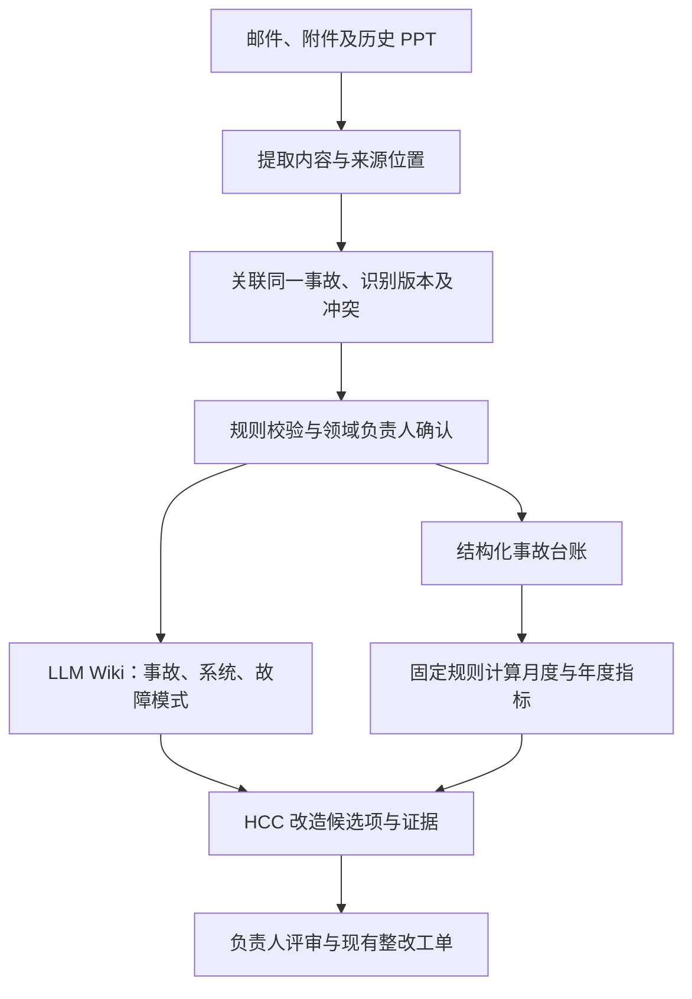

# Lending Incident Wiki

AMH / HASE 历史事故与 RCA 知识管理方案 · **讨论稿，尚未批准实施**

## 一页方案

### 目标与背景

汇总历史 incident 和根因分析（RCA），支持月度／年度稳定性分析，并为 HCC modernisation 提供可追溯的改造依据。已知资料主要在**邮件和 PPT**；数据完整性、历史年份、HCC 具体范围及获批 AI 工具尚待确认。先共同设计并达成一致，再实施。

### 整体设计

采用 **结构化事故台账 + Karpathy 式 LLM Wiki + 趋势报表**，优先复用已有平台。

LLM 提取、关联和归纳；程序计算；领域负责人确认根因和改造判断。台账与 Wiki 引用同一事故 ID 和来源版本。保留未知、缺失及冲突，不以推断替代已确认事实。

### 交付物

| 交付物 | 内容 |
|---|---|
| 事故台账与数据字典 | 唯一事故 ID、范围、时间、严重级别、原因、整改关联；来源清单、覆盖情况及统计口径 |
| LLM Wiki | 事故摘要、系统／组件、重复故障模式及经验；关键事实定位到邮件或 PPT 页码 |
| 趋势报告 | 数量、严重级别、恢复时长、重复问题、RCA 覆盖及整改进展，可下钻至事故 |
| HCC 改造证据清单 | 事故 → 问题机制 → 控制缺口 → 改造候选项 → 验证方式与负责人 |
| 维护机制 | 新资料吸收、RCA 修订、受影响页面检查及人工审核责任 |

### 试点计划

建议 **两周**，以样本、访问条件和负责人到位为前提；这是讨论估算，不是交付承诺。

| 阶段 | 工作与产出 |
|---|---|
| 第 1–2 天：共同设计 | 确认来源、范围、指标和 AI 环境；选取 5 个事故，覆盖邮件链、多版 PPT、图表及混合来源 |
| 第 3–5 天：提取验证 | 核对正文、表格、图片与备注；验证来源定位、事故关联和版本处理，决定是否扩样 |
| 第 6–8 天：扩展样本 | 通过验证后扩至约 20–30 个事故，生成台账、Wiki、报表样例和改造候选项 |
| 第 9–10 天：联合评审 | 核实事实和候选项价值，评估校正成本，决定全量范围、投入与责任 |

### 验收与待决事项

样本清单无漏计、重复可解释；数字可复算；关键事实有准确引用；缺失不编造；一次 RCA 修订可识别关联页面；候选改造交由负责人评审。样本仅验证方法，不能推断全量趋势。

需共同确认：历史范围与权威来源、HCC 关注点、指标口径、获批环境、参与人及长期维护负责人。未核实资料完整性前，报表标注“基于已收集资料”。

## 讨论入口

| 文档 | 用途 |
|---|---|
| [设计细节](docs/design.md) | 邮件/PPT 处理、台账、Wiki 与维护规则 |
| [试点与验收](docs/pilot.md) | 样本选择、验证步骤、通过条件 |
| [待决问题与决定记录](docs/decisions.md) | 讨论状态的唯一记录；尚未作出的决定不写成定论 |
| [事故记录模板](templates/incident.md) | 讨论一个事故需要保留哪些信息 |
| [改造候选项模板](templates/modernisation-candidate.md) | 把历史证据连接到可评审的改造建议 |
| [调研来源](docs/references.md) | 原始资料及本方案如何使用它们 |

讨论时引用 `D-01` 等稳定编号，可在 Issue / PR 中提出修改；达成共识后更新决定记录及对应正文。当前仓库只保存方案和空白模板，尚未导入、分析任何内部事故资料。
