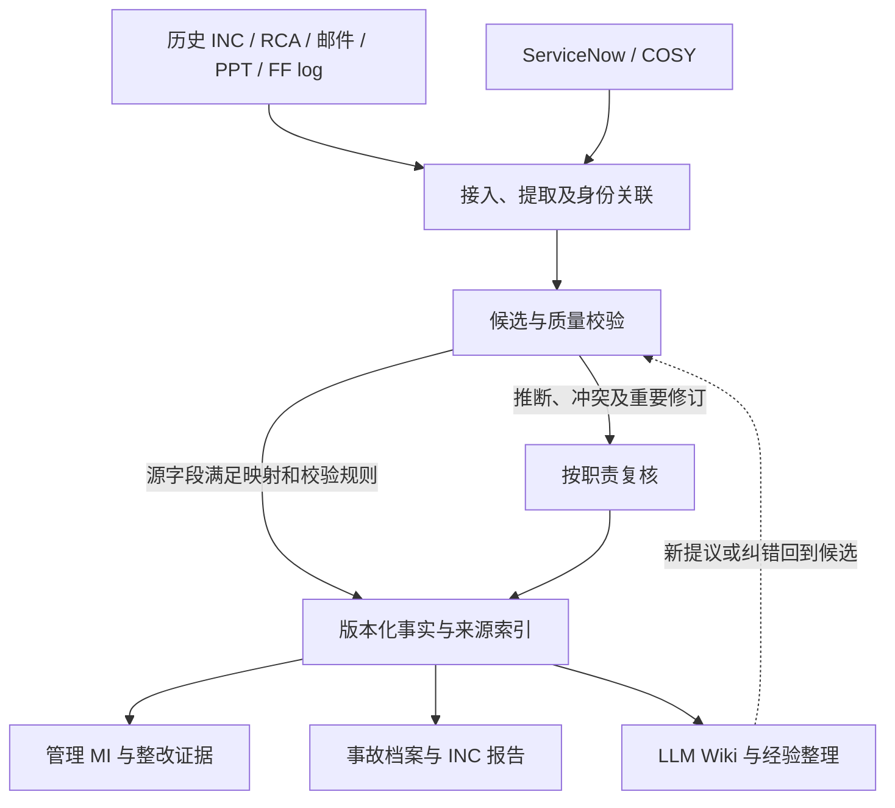

# Production Support & MI

> 产品说明书 v0.3｜2026-10-26 同步原型范围｜供共同设计，尚未批准真实实施
>
> 当前重点：MVP1 历史事故整理、新事故同步与复盘、INC 报告、管理层 MI。

本说明展开 [README 的产品范围](../README.md)，决定及未决事项统一记录在 [D-01 至 D-10](decisions.md)。[HTML 原型](mi-dashboard.html)仅使用虚构资料和预置响应；页面可运行不代表 Agent、数据接入或试点已经实现、通过验收。

全景图供管理层与 SME 讨论产品职责和数据路径。仓库组织区分已获用户同意，具体数据规则、环境和实施仍待共同确认；图示不是已建系统。

## 1. 产品定位与设计判断

建议定位为：**生产事故的证据、复盘与管理决策平台。让管理层知道哪里需要介入，让支持团队用已有记录完成可信复盘。** Dashboard 是管理入口，INC 报告是阶段性成果，LLM Wiki 是积累和阅读经验的方式。

**已确认的产品边界**：管理层 MI 优先；MVP1 覆盖历史整理、新事故同步、复盘与单次 INC 报告；事故处理仍在 ServiceNow / COSY。FFer 在既有系统处理和更新工单，本平台复用这些记录。接口能力、字段权威、数据规模、人工整理耗时及 SME 可用投入尚未核实。

**本版建议，尚待用户确认**：以统一事故档案贯穿两条路径；按事实与判断分级复核；Wiki 与 MI 共用版本化事实；先保持一个产品代码仓库，是否拆仓由团队、环境和发布边界决定。历史 FF log 作为事故补证和关联输入建议纳入 MVP1，通用检索、助手和 SOP 发布仍在 MVP2。此前“至少两个 repo”的对话建议不作为已定架构。

当前设计最需检验的四个假设：

| 假设 | 若直接采用的风险 | 本版建议 |
|---|---|---|
| 收集足够多旧资料就能做 MI | 文档数量不代表事故清单完整，缺失和重复会扭曲趋势 | 先核对一个限定范围的事故目录，再补证据与解释 |
| 所有数据均须 Agent 整理、SME 确认后才能展示 | 新事故不可见；SME 花时间重复确认已有工单字段 | 源记录通过身份与映射校验后可展示；推断、冲突及知识发布另行复核 |
| LLM Wiki 是所有结果的必经中间站 | Wiki、CSV、数据库可能分别维护不同版本的事实 | 结构化事实与引用统一维护，Wiki、MI、报告从中生成 |
| 数据处理和展示需要两个 Git repo | 仓库边界先于实际责任和接口，增加同步维护 | 先分清能力与存储边界，再决定拆仓 |

成功应表现为：管理问题能追到证据与责任人、报告准备和核对耗时下降、FFer 重复录入减少。不能用 Wiki 页数、处理文档量或生成报告量代替产品价值。减少事故复发是长期目标，短期样本不足以归因于本平台。

## 2. 目标用户与职责

| 用户 | MVP1 主要工作 | 使用结果 |
|---|---|---|
| 管理层 / 业务负责人 | 先看业务影响、重复问题与受阻整改，再下钻证据 | 判断优先级、需要协调的责任和验证缺口 |
| FFer / 一线支持 | 在原系统处理；恢复后只补本平台识别出的必要缺口 | 复用处理过程形成 INC 草稿，避免重写时间线 |
| SME / 事故与报告负责人 | 集中处理因果判断、冲突、重要修订与报告复核 | 确认有依据的结论，不逐条重复审批源字段 |
| 资料整理 / 数据负责人 | 建立来源清单、关联事故、核对冲突、校验批量入库 | 可追溯台账、Wiki 和数据质量记录 |
| HCC modernisation 团队 | 后续引用历史机制、整改与验证证据 | 支持目标设计、测试、监控与治理讨论，归入 MVP2 |

上述为职责建议，实际人员、权限及报告审批责任仍待 D-07 确认。HCC 背景已确认是整个系统核心由 IBM iSeries 迁移至新的开放平台；具体目标技术栈和迁移方案未知。

## 3. 范围与分期

| 分期 | 模块 | 产品范围 |
|---|---|---|
| MVP1 | 管理层 MI | 多维筛选、连续下钻、指标口径、事故与整改明细、来源与缺失状态 |
| MVP1 | 历史整理与导入 | 批量整理邮件、PPT、INC / RCA；建议纳入相关历史 FF log 补证；形成带引用的候选、复核队列与校验后的结构化记录 |
| MVP1 | 新事故同步与复盘 | 从源工单建立后持续同步可获取的记录；整理时间线、来源状态、业务验证及复盘补充 |
| MVP1 | INC 报告 | 基于单次事故的来源快照生成草稿，核对缺口、人工复核，保留版本并输出报告 |
| MVP2 | 知识检索与支持助手 | 检索 case / SOP / FF Log；辅助现场日志摘要、排查参考及 RCA 草稿 |
| MVP2 | 知识维护与共享规范 | 原 FF Log 结果回流、待复核 case / SOP 修订、共享 Skills、维护与退役 |
| MVP2 | 周期报告与现代化反馈 | 月度／季度报告中心；历史机制到设计问题、测试与监控建议 |

**单次事故 INC 报告属于 MVP1；独立的月度／季度报告中心属于 MVP2。** MVP1 Dashboard 仍可按既定时间范围查看 MI。当前没有上线日期承诺。

现阶段不包含：替换既有事故处理平台、重新派单或执行生产操作、Agent 自动修复、自动确认根因、默认把所有生产日志提交 Git，以及未评估的全系统实时接入。先盘点 ServiceNow / COSY 已有报表、复盘与导出能力；能够复用的部分优先复用，再决定需要定制哪些页面与服务。当前原型展示的模块数量不等于首版必须建设的独立系统数量。

建议将 MVP1 按验证顺序推进，两个用户场景均保留：

1. **验证整理方法**：沿用 P-01 至 P-06 的小样本，核对提取、归并、引用、修订和人工成本；不以该样本推断总体趋势。
2. **打通一个管理闭环**：选一个共同确认的系统和时间范围，对账事故目录，完成历史导入 → MI 下钻 → 一起事故的复盘／INC → 整改证据回查。范围外的年份明确尚未覆盖。
3. **接入新增变化**：在同一事故模型上验证新建、恢复、RCA 修订及同步异常。若没有 API，先评估受控增量文件，显示实际截至时间；不能宣称实时跟踪。随后依据成本与能力扩到更多来源和年份。

这是先后顺序建议，不把新增事故移到 MVP2，也不承诺先处理完所有历史资料再上线。接入能力盘点应与前两步同步进行。

## 4. 场景一：历史资料批量整理与导入

**范围与事故目录 → 批量接入 → 提取和关联候选 → 校验与按需复核 → 发布结构化记录 → MI / Wiki / INC。**

1. 按获准年份、系统和资料范围建立来源清单，并尽可能用权威事故目录对账。记录邮件链、附件、PPT 及 INC / RCA 的 ID、位置与版本；相关 FF log 可补充处理证据。没有完整事故目录时标记覆盖未知。
2. 提取正文、表格、图示及备注，保留邮件片段或 PPT 页码。转发、重复附件和 RCA 修订不作为新事故。
3. 优先按原事故 ID 关联；没有 ID 时只提出关联候选，由人工确认。相似症状不能直接视为同一事故或根因。
4. Agent 形成字段、关联和摘要候选，展示原文定位与缺口。整理人核对提取质量和身份，SME 核对因果及专业判断；已有正式确认结果可引用原确认记录。存在争议的字段保持冲突，不必阻塞整起已核实事故计数；身份不明的候选单列，不计入正式事故总数。
5. 在整理工作区预览 Wiki；经相应规则校验／复核后，按版本发布结构化记录并生成正式 Wiki。CSV 是可选交换方式，建议至少包含事故、措施和来源关联，附批次、审核状态及版本清单。实际字段、时区和空值规则待确认。
6. 导入前列出新增、更新、重复和错误／待核对记录；导入后核对回执。重复导入同一来源版本不增加事故数；新修订更新既有记录并保留依据。
7. 先核对批次结果与事故目录，再供 MI 使用。FF log、来源文件、事故分别计数：多条 FF log 可关联同一起事故，没有事故依据的普通 FF log 仍保留为支持记录，不强行转成 INC。

不要求每份历史材料均生成 Wiki 页面。优先补齐影响 MI 和复盘的字段，跨事故主题只在确有复用价值时整理。失败文件、待匹配记录、冲突及暂缓项留在处理队列；批量完成不能掩盖这些缺口。具体数据库与处理机制尚未选定或实施。

## 5. 场景二：新事故同步 → 复盘 → INC 报告

| 阶段 | ServiceNow / COSY 中的处理 | 本平台的协助 |
|---|---|---|
| 事故建立 | 创建工单，记录现象、影响、严重级别和负责人 | 关联同一事故，展示源状态、更新时间和首次同步情况 |
| 调查与恢复 | 记录调查、操作、交接、执行结果及业务恢复 | 整理可获取的事件时间线；列出信息缺口，供 MI 查看已知进展 |
| 复盘 | 沿用既有流程确认 RCA、整改工单及处理责任 | 关联本次业务验证，整理经验、缺失影响量与后续核对项，保留来源 |
| INC 草稿 | 复用原记录及既有审核责任 | 生成概况、影响、时间线、恢复与验证、RCA、整改、复盘摘要及缺口 |
| 复核与后续修订 | 按确定后的正式审批和归档流程处理 | 保留报告版本、来源快照、复核状态；来源或补充改变后提示重新核对 |

从事故处理中即可形成缺项草稿；“已恢复”不等于“根因已确认”“整改已完成”或“报告已复核”。建议在统一事故详情中分列处理、复盘、报告和整改验证状态；不合并成一个“完成”标志。本平台不把本地复盘编辑当作源工单状态变更。

同步应区分事件时间、源记录更新时间与平台同步时间。失败时保留并标明最后已知快照；部分来源未收到时显示缺失，不补造中间过程。如果接口只提供当前状态，不假定能获得全部历史事件。源工单创建前的电话／告警能否获取尚未确认。

INC 每版绑定事故 ID、原工单、来源与证据版本、资料截至时间及复核记录。新证据或源 RCA 修订使受影响报告待复核，旧版保留原内容；未确认根因不生成定论。正式模板、审核条件、输出格式以及最终提交／归档位置仍待确认。

建议区分处理中简报、恢复后复盘草稿和正式 INC，复用同一档案。是否允许正式报告保留“根因未明＋后续负责人和期限”，取决于组织报告规则；不为完成报告而补造 RCA，也不默认必须等所有整改结束。源流程已有的正式审核应复用，避免本平台再走一遍相同审批。当前原型要求 RCA 确认才可模拟完成复核，仅是演示规则，未据此确认正式政策。

## 6. 数据组织与权威边界

| 对象 / 内容 | 组织方式与权威边界 |
|---|---|
| 事故身份 | 内部稳定 ID 关联原系统 ID；历史入库与后续同步遇到同一事故时归并，不重复计数 |
| 处理状态、负责人、执行动作 | 引用 ServiceNow / COSY；两系统具体字段权威、冲突规则和 ID 映射仍待确认 |
| 原始资料与证据 | 保留来源 ID、位置、版本、时间、访问范围；原则上只读，派生内容继承来源限制 |
| RCA | 记录确认状态、结论来源和版本；模型假设与源流程确认结果分开 |
| 整改措施 | 关联 Problem / Action 工单、负责人、期限、状态及查询时间；有效性证据单独记录 |
| Wiki 与复盘补充 | Wiki 引用同一版本化事实；新增判断进入候选／复核流程，不能只修改 Wiki 而让 MI 保持旧结论 |
| INC 报告 | 单次事故的版本化输出；报告修订不新增事故，历史复核不自动适用于新来源 |
| FF Log / case / SOP | FF log 为处理记录，case 为经验整理，SOP 为适用条件明确的操作知识；互相关联但不等同于事故，也不自动逐级升级 |

优先评估单向读取或受控导入，实际采用 API、事件通知、定时同步还是导出文件，取决于原平台能力。当前不包含自动工单写回。

### 6.1 分级信任与复核

“正式分析只使用达到相应可信条件的数据”比“平台只存 SME 确认的数据”更准确。平台需要管理来源、候选、已采纳内容和历史版本；它们的可见范围及用途不同。

| 内容 | 建议进入可用视图的条件 | 使用边界 |
|---|---|---|
| 源系统结构化事实，如工单 ID、状态和时间 | 确认字段权威与映射，校验身份、格式及同步版本 | 可进入事实 MI，标明“源记录”；不标作 SME 审核 |
| 从邮件／PPT／FF log 抽取的候选 | 有原文定位；先用代表样本验证提取规则；关键字段按约定核对 | 未达条件只在整理／复核工作区；模型自评置信度不作为发布许可 |
| 原 RCA 中已有确认结论 | 核实来源版本、确认身份／状态及适用范围 | 复用原确认，不重复审批；缺少确认依据仍是待确认 |
| 新因果判断、重复机制关联、冲突取舍 | SME 或约定领域负责人确认，留依据与版本 | 才计入对应的已确认根因／重复问题分析 |
| INC 定稿与 SOP 发布 | 分别按报告流程和知识发布规则复核 | 报告审核不自动批准 SOP，成功恢复不自动证明原因正确 |

复核按字段或结论绑定版本，避免一枚“已审核”标签覆盖所有内容。队列优先呈现会改变严重级别、业务影响、根因归类或发布报告的差异；同时显示原值、候选值、引用、受影响统计／报告和负责角色。对未知可要求补证或保留未知，不迫使 SME 选择一个原因。自动放行和抽检规则仍需 D-02 / D-07 共同确认。

### 6.2 能力、存储与仓库分开设计

- **能力**：接入／整理、校验／复核、查询／报告职责明确。历史批处理与新增同步共用身份、证据和发布规则，可以有不同运行任务。
- **存储**：原始材料留在获准来源或受控资料区；候选与已采纳记录逻辑隔离，保留来源版本；结构化存储支持查询和统计，Wiki 提供阅读和分析视图。Git 适合代码、规则、模板与获准知识版本，不作为事故数据库或同步队列。
- **仓库建议**：目前先保留 `production-support-mi` 一个产品代码与设计仓库，内部区分处理、查询和展示职责。运行数据的权限与保留策略独立管理；一个代码 repo 不意味着所有人能访问同一批资料。
- **拆仓条件**：若整理服务和应用由不同团队维护、需要独立代码访问权限／交付节奏，或受控环境要求独立交付，再评估两个仓库。分开运行并不自动要求分仓；数据敏感也不能仅靠分仓解决。
- **若最终拆成两个**：整理端发布版本化记录包，应用端校验后接收并返回回执。契约必须约定对象 ID、字段／分类版本、来源、复核状态、更新／撤回和失败重放，避免两边各自确认同一结论。契约可先放在现有仓库，不预设第三个仓库。

用户在本轮同意区分产品代码仓库与知识内容仓库：整理工具、服务和 Dashboard 代码先集中在现有仓库；LLM Wiki、经验、来源索引及知识版本独立维护，内容更新不要求重新发布 Dashboard。全景图按这一方向表达。具体知识仓库名称、获准环境与访问／发布规则仍按 D-06 / D-10 确认；尚未选择数据库、框架或模型，也未创建第二个仓库。

## 7. 管理层 MI 设计原则

首页建议按管理问题组织，先显示需要关注的事项，再提供多维分析。每条管理提示带构成记录、缺口与可回查证据；没有依据时显示问题，不由模型自动作出管理结论。

| 管理问题 | 首屏信息 | 下钻后的决定依据 |
|---|---|---|
| 哪些业务仍受影响，恢复到什么程度？ | 未恢复事故、严重级别、已知业务影响和数据截至时间 | 恢复时间线、验证记录、源工单与负责人 |
| 哪些问题在重复发生？ | 已确认重复机制、相关事故和影响；候选单列 | 原 RCA、归组依据、已采取措施及验证缺口 |
| 哪些整改需要管理协调？ | 高影响事故相关的逾期／受阻措施、Owner、期限及阻塞原因 | 原措施工单、跨团队依赖和有效性证据 |
| 我们对这些数字有多大把握？ | 覆盖范围、同步延迟、未确认 RCA、待核对事故及缺失字段 | 来源清单、质量队列和修订记录 |

避免默认按团队事故数做绩效排名，也不生成缺少业务量和影响依据的综合“健康分”。管理关注点是系统风险与改进条件。Google SRE 对复盘的强调包括促成因素、可追踪的预防行动与复核；这里据此提出产品取舍，而非照搬其内部流程。见 [Postmortem Culture](https://sre.google/sre-book/postmortem-culture/) 和 [Postmortem Analysis](https://sre.google/workbook/postmortem-analysis/)。

- 管理层可切换维度、逐层下钻并返回；KPI 直接定位构成记录。事故数量按唯一事故计，逾期按整改措施计。
- 候选维度包括发生月份、AMH / HASE、故障类型、严重级别、根因分类、负责团队、重复问题、RCA 和整改状态；正式定义及 Owner 待 D-04 / D-10 确认。
- 每项指标显示时间范围、过滤条件、计数单位、有效样本数、缺失量、来源覆盖与更新时间。缺资料显示未知，不替换成零。
- 数字来自结构化查询或确定性计算；LLM 可解释已计算结果、摘要及起草文字，不从少量检索结果估算全量。
- 恢复时长与工单关闭时长分开；未知恢复时间不填零。工单关闭、措施完成与整改验证有效分开。
- 统计重复根因须有已确认关联；样本数量变化不能单独证明稳定性改善。跨期比较需口径及覆盖可比。
- 历史事故状态和当前工单状态注明各自快照，避免将多年前的措施状态当作今日进展。

**虚构路径示例**：AMH → 批处理 → 已确认调度依赖 → 逾期整改。若下钻看到涉及 1 起事故、2 项措施但没有有效性证据，管理层可以确认“整改验证仍有缺口”，进一步协调负责人、阻塞和验证计划；不能据此断言“调度团队能力不足”或“完成这两项就不会复发”。页面应帮助区分可下的结论与尚需调查的问题。

### 7.1 用户入口建议

| 入口 | 主要使用者 | 页面与下一步 |
|---|---|---|
| 管理总览 | 管理层 | 风险／影响、重复问题、整改关注、数据可信度；下钻统一事故详情 |
| 事故档案 | FFer、复盘与报告负责人 | 概况、时间线、证据、RCA、措施、INC 版本在同一起事故内查看；补缺口、查看草稿、回原系统 |
| 资料与质量 | 数据负责人、SME | 历史批次、同步健康、待匹配、冲突、待复核；从差异直达原文与影响范围 |

历史整理与新增同步是进入同一档案的两种方式；INC 不需要用户重新选来源、再填一份事故。按角色显示相关任务，管理层无需看到批次处理细节，FFer 无需学习 Git 或 CSV。MVP2 页面保留为后续能力，默认不占据 MVP1 主导航。

## 8. MVP2 保留的产品能力

知识检索支持按系统、现象、错误码及知识类型查找 case / SOP / RCA / FF Log，查看版本、来源、适用条件和退役状态。支持助手基于获准日志与历史依据辅助排查，说明事实、假设、建议、验证和停止条件；FFer 仍在既有授权下决定并处理。

结果回流路径为：关联原 FF Log → 补充处理结果与验证证据 → 形成同次处理的待复核修订 → SME 复核 → 发布。失败或升级场景只能沉淀相应案例，不能自动变成成功恢复 SOP；补充改变后需重新复核。

月度／季度报告中心复用统一口径和台账。HCC 反馈以“历史机制 → 控制问题 → 设计检查项 → 测试／监控建议”组织，迁移适用性判断独立于历史 RCA；更换平台不自动证明风险消除。具体目标设计、验收和长期维护责任仍待确认。

Git Repo + LLM Wiki + VS Code Agent 保留为待评估的工作入口，不能替代对获批环境、数据权限、管理层入口和原平台能力的确认。

## 9. 当前原型覆盖与限制

[HTML 原型](mi-dashboard.html)可离线打开。顶部为“管理总览、事故档案、资料与质量”三个 MVP1 入口，五个 MVP2 模块默认折叠在“后续能力”。

右上角提供简体中文、繁體中文、English 切换，覆盖导航、筛选、指标、弹窗及动态演练内容。语言偏好保存在当前浏览器；首次使用跟随浏览器语言，其他语言暂回退 English。切换不重置查询、所选事故、同步进度或报告版本；刷新仍清除演练状态。知识示例支持三种语言的关键词匹配，仍非语义检索。

原始来源片段标注并保留原语言；事故 ID、证据引用、日期／时区、CSV 字段和值不随界面翻译改变。INC Markdown 可按当前语言下载，文件名附语言标识，保持原版本和状态。产品说明及全景图仍为中文。以上仅为预置虚构内容的呈现演示；真实多语言资料、报告译文的复核责任与正式导出规则需另行共同确认。

**2026-10-26 已将三入口与统一事故档案加入虚构交互。** MI 下钻后在同一事故内切换概况与复盘、来源与确认、INC 报告，返回 MI 保留查询条件；处理状态、RCA、报告与整改有效性分别呈现。资料与质量集中历史批次、同步状态、差异核对与 FF log 来源索引。已有源审核直接引用，RCA 未确认的已知事故仍进入演练台账。

字段级局部发布、自动抽检、统一发布契约及 Wiki 联动仍是设计建议。历史冲突演练保留整起暂缓选项；新增事故报告保守要求补齐 RCA 等关键资料后才能模拟复核，正式缺项政策待定。历史档案未提供 INC 正文，页面显示缺口，不套用新增事故报告。

- **原有 MI 集合**：2026 年 7–9 月共 30 起虚构事故，支持多维筛选、下钻、整改与证据查看；整改使用 2026-09-30 固定快照。
- **本次流程演练集合**：历史流程预置 1 起旧记录；6 份来源整理为 3 起候选，完整核对入库后新增 2 起、更新 1 起；新事故同步后共 4 起。两套集合明确分开展示，不相加解释为生产全量。
- **FF log 来源示例**：2 条预置处理记录，1 条关联既有历史事故、1 条身份待核对；仅展示补证与来源关系，不增加事故数，未实现真实 FF log 批量解析或知识仓库连接。
- **异常与版本**：可演练冲突暂缓、重复导入、同步失败、部分来源、受限附件、验证错配、缺项草稿及源 RCA 修订后的报告重审。
- **导出**：可下载虚构事故／措施／来源 CSV 和 INC Markdown。模拟入库、同步、复盘与审核仅存在当前页面，刷新清除。
- **能力边界**：提取、知识搜索、助手和同步响应均为内置示例，未接模型、真实 Wiki、数据库或工单平台；无真实上传、生产执行、写回、审批、发送或发布。

已有计算、交互及浏览器检查仅验证虚构原型。它们不能证明真实资料提取准确、模型有效、平台集成可行或试点验收通过。

## 10. 验证方向与待决事项

范围、指标与接入条件共同确认后，再制定获准样本和实施安排。原 [P-01 至 P-06](pilot.md) 仍为未验证的 INC / RCA 资料整理试点，不能自动覆盖全部 MVP1。

| 验证方向（建议） | 需要取得的证据 | 对应决定 |
|---|---|---|
| 历史资料与入库 | 事故归并、来源定位、冲突处理、重复导入及更新准确性；真实覆盖与校正成本 | D-01 / D-02 / D-05 |
| 同步可靠性 | 事件历史可获取性、延迟与缺失表现、重试不重复、跨源 ID 与字段一致性 | D-02 / D-10 |
| 报告质量 | 关键事实引用、未知保留、复盘缺口、人工修订成本和来源变化后的重新复核 | D-05 / D-07 / D-10 |
| MI 可靠性 | 明细与汇总可复算、缺失样本解释、统计口径及责任人 | D-04 / D-10 |
| 环境与责任 | 获批 AI / 存储、访问范围、数据保留、平台和报告维护人员 | D-06 / D-07 |
| 是否推广 | 依据真实试点证据决定扩展、修订或暂缓 | D-08 |

建议先取得现状基线，再与 Owner 约定阈值：报告准备／修订的人工分钟数、每起事故重复录入次数、每批资料核对时间、SME 待审量与等待时间、同步时效、目录对账差异及关键字段错误。不能先承诺未经测量的节省比例。

下一轮设计验证应覆盖：未确认 RCA 的已知事故仍可计数；未匹配 FF log 不增加事故数；一次根因修订能定位受影响的 MI／Wiki／报告；报告和源工单状态不混用；同步失败显示旧快照；没有来源覆盖依据时不显示全量趋势。它们是待确认的验证场景，不是已通过的新增验收项。

若拿不到可对账事故目录，先交付有覆盖说明的资料分析；若无法取得增量来源，不宣称早期事故跟踪；若复核积压持续高于处理能力，先缩小整理范围或调整规则。缺乏这些条件时，增加页面和模型并不能形成可信 MI。

当前优先待决：管理层最需要的三个判断及对应行动（D-04 / D-10）；一个可获准的范围与源字段清单（D-01 / D-02 / D-06）；INC 模板、审核责任及 SME 投入（D-07 / D-10）。这些将决定最终 UI、自动化程度及是否拆仓。量化阈值、人员、同步 SLA 和交付日期仍未确定，真实资料处理仍需相应授权。

## 11. 版本与文档维护

| 版本 | 日期 | 变化 |
|---|---|---|
| v0.1 | 原始文件未注明日期 | 原《Production Support & MI Report》，以团队知识基础试点为起点、MI 后续评估 |
| v0.2 | 2026-10-25 | 管理层 MI 优先；补齐 MVP1 两类数据路径、单次 INC 报告及源平台处理边界；MVP2 能力保留；标明虚构原型与未决条件 |
| v0.3 | 2026-10-25 | 重审产品目标；提出统一事故档案、分级复核、三个角色入口、分步验证及条件化拆仓；历史 FF log 补证建议纳入 MVP1；均待共同确认，未改 HTML |
| v0.3 原型同步 | 2026-10-26 | 虚构 HTML 按三个入口重组；MI 下钻统一事故档案，INC 留在本事故内；补充差异核对与 FF log 来源示例，折叠 MVP2；真实数据机制及验收状态不变 |
| v0.3 多语言原型 | 2026-10-26 | 增加简体中文、繁體中文、English 切换与语言偏好；保留来源原文、稳定数据字段及报告版本；真实翻译与审核机制未实施 |

仓库命名采用 `production-support-mi`，产品名称为 **Production Support & MI**，原型保留 **Production MI** 简称。README 维护范围，本文展开产品说明，[设计细节](design.md)维护设计建议，[决定记录](decisions.md)维护唯一讨论状态；原始讨论历史不改写为新结论。
